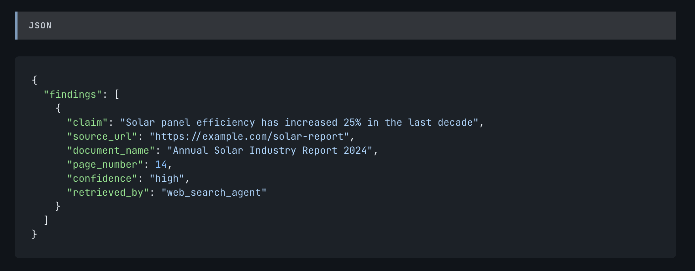

# Subagent invocation &amp; context-passing

Invocation is how the coordinator starts a subagent

Context passing is how it gives the subagent what it needs

1.2 = architecturre

1.3 = wiring

THE TASK TOOL

The API mechanism that makes multi-agent orchestration work in Claude Agent SDK

The coordinator's allowedTools function must include 'Task' or 'Agent' (new name for it)

Without that being there the coordinator can't do anything like this

You can waste your time defining subagents but it has no way to call them

DEFINING SUBAGENTS

Each subagent is defined by an AgentDefinition - this specifies:

- Description
- System prompt
- Tool restrictions

CONTEXT PASSING

Agents only have what they are given - no outside context - they are dumb robots

This is why most multi-agent systems break - the agents can't see things, don't know enough

Here are the rules:

- include all findings from previous agents
- use structured data - make a distinction between content and metadata
- give the agent goals - not step-by-step instructions (too rigid, can lead to agents halting)

Here's an example of structured metadata:

Then all the data is carried as metadata making it easy to compile a report.

The metadata needs to be carried over the same way to each subagent, not breaking chain.

--

When a coordinator needs many subagents at once, it should bundle several Task tools in one response. 

PARALLEL SPAWNING = multiple agents spawned together

SEQUENTIAL SPAWNING = agents spawned one after another, once a task is completed

FORK SESSION

fork-session allows for a degree of A/B testing of different agent workflows

The coordinator can use the same analysis but 'fork' much like Eth into another dataset
