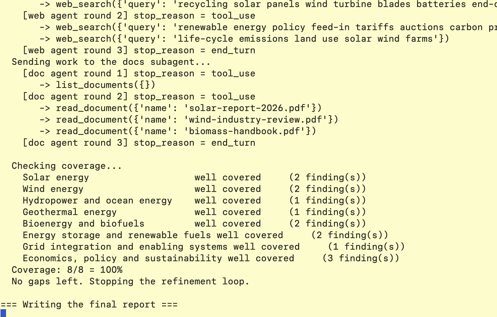
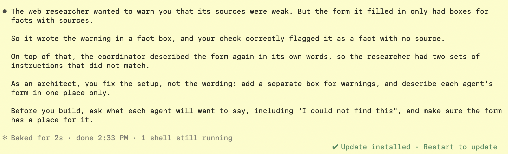
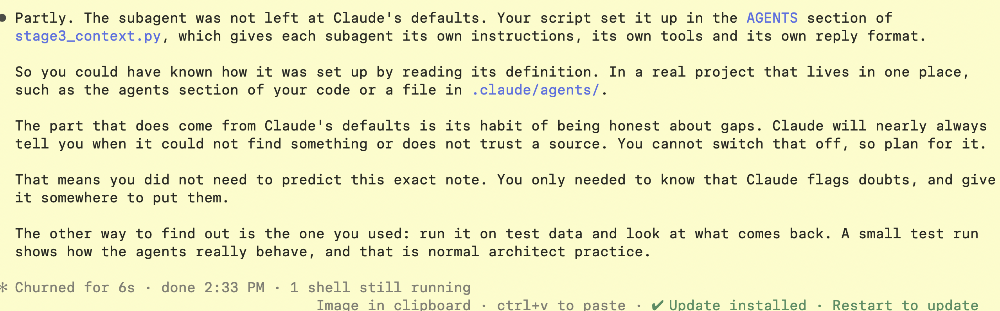

# Exercise 1.1 - 1.3

Mon 26 Oct 2026

Got Python set up, added the Claude API key that DJ provided, updated Python version

Completed the exercise: run Python script that searches for info on the Eiffel Tower and then performs a simple calculation.

Then I ran the coordinator script and ran a load of sub agents.

It was a simple report assembly task. I liked seeing how they all worked together.

The principle - get Claude to run tasks programmatically and output an MD - is something I often do in my own workflows.

But the actual idea of using coord/agents via Python is a new one.

Picking it up tomorrow.

**TUES 27 OCT**

Picked this back up

Got to 100 per cent coverage

It turned out the issue was actually with the prompt - the acceptance criteria for a good answer wasnt tight enough

Then when the coordinator received the information back and it went through the synthesis agent, it wasnt happy

So it kept giving 50-60pc results

Picking it back up at 12

=

WED 28 OCT

I ran a few more scripts

The coordinator did a good job but one of the subagents tried to add its own descriptive notes

There was no metadata to account for the subagent making its own notes

I asked how I could have known:

I had set up the subagents in the AGENTS part of the python script.

I didnt think to give it a space to add notes.

This is one to return to early next year and write from scratch.
