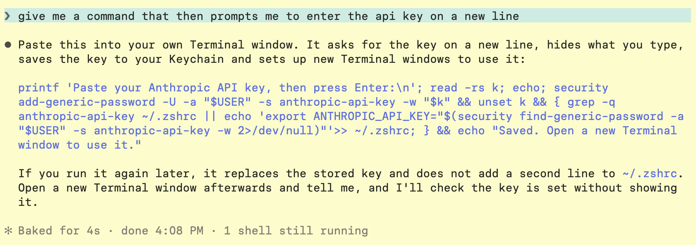
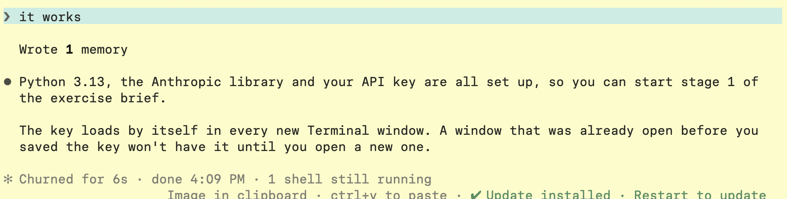
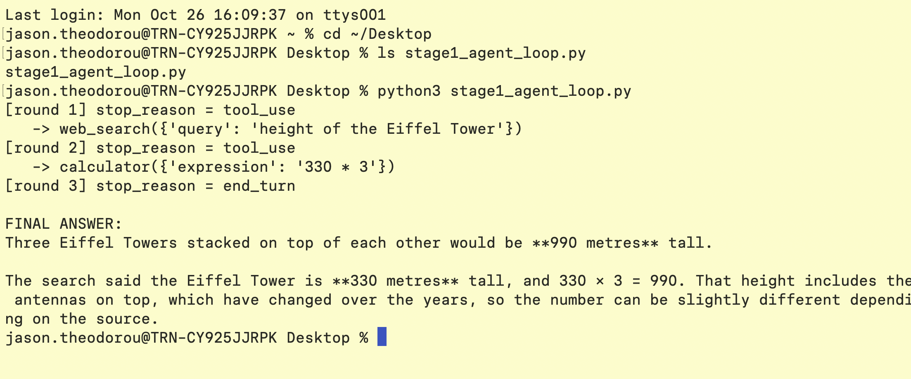
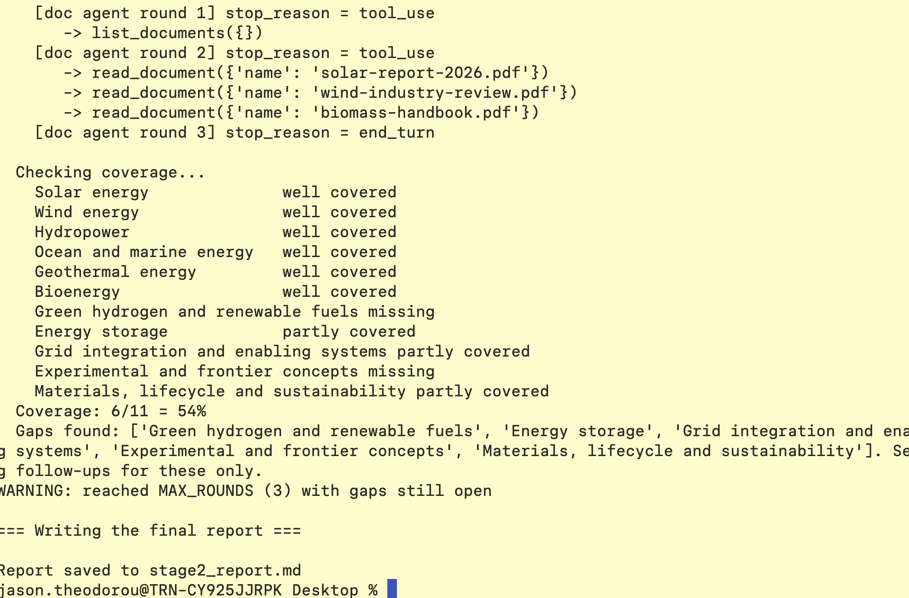

# Exercise 1.1 - 1.3

Mon 26 Oct 2026

Got Python set up, added the Claude API key that DJ provided, updated Python version

Completed the exercise: run Python script that searches for info on the Eiffel Tower and then performs a simple calculation.

Then I ran the coordinator script and ran a load of sub agents.

It was a simple report assembly task. I liked seeing how they all worked together.

The principle - get Claude to run tasks programmatically and output an MD - is something I often do in my own workflows.

But the actual idea of using coord/agents via Python is a new one.

Picking it up tomorrow.
